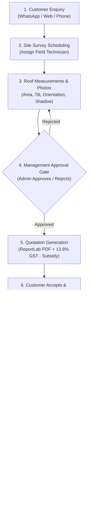
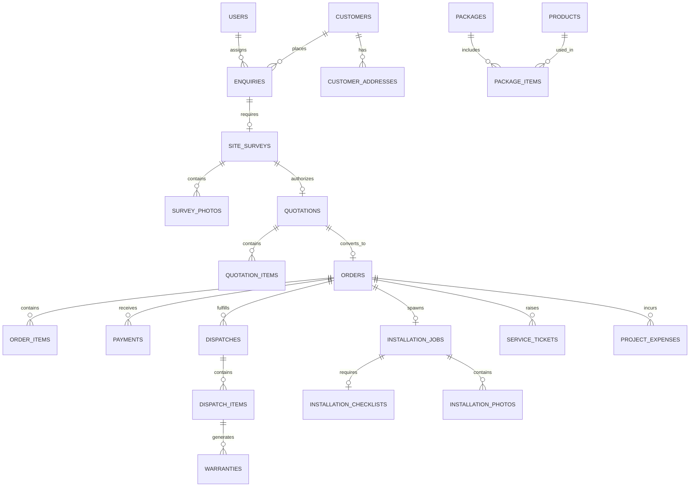

# SunPower Solutions — Solar Installation Management System
## Evaluator Presentation & Architecture Defense Guide

---

### 1. The 30-Second Elevator Pitch (Start with this)

> *"SunPower Solutions is a centralized, production-grade **Modular Monolith REST API** engineered to manage the entire rooftop solar business lifecycle for residential and commercial installations (1 kW to 5 kW On-Grid and Off-Grid).
> 
> We built it using **FastAPI**, **PostgreSQL**, **SQLAlchemy 2.0 (Async)**, **Pydantic v2**, and **Alembic**. It eliminates paper-based errors by enforcing strict business validation gates: site surveys must be approved by management before quotes can be prepared; quotation bills of materials prevent missing components; hardware serial numbers are tracked through dispatch; warranty certificates are automatically generated upon delivery; technicians complete mandatory 7-point electrical commissioning tests; and management monitors real-time project-level gross profit and margin."*

---

## 2. The 10-Step End-to-End Business Flow

Walk your evaluator through the complete lifecycle step-by-step:

### Detailed Lifecycle Phases:
1. **Lead Capture & Enquiry:** Captures enquiries across WhatsApp, phone, and web. Sales reps record capacity (1kW-5kW), type (On-Grid/Off-Grid), and electricity bills, with automated follow-up reminders.
2. **Site Survey:** Field technicians visit the roof and log shadow-free area, roof tilt, cable distance, sanctioned load, and upload photos.
3. **The Approval Gate (Critical Rule):** Quotation creation is **strictly locked** in the database until an Admin reviews and approves the survey measurements.
4. **Quotation & Pricing Engine:** Pulls pre-configured packages (e.g., 3kW On-Grid BOM), calculates hardware costs, adds installation and transport, applies discounts, calculates 13.8% GST, deducts government subsidies, and renders a customer-ready **ReportLab PDF**.
5. **Order Conversion:** Converting an accepted quote automatically reserves inventory and initializes an `InstallationJob` with a blank 7-point checklist.
6. **Payment Milestones:** Flexible milestone recording: Advance (20%), Pre-dispatch (60%), and Final (20%), generating downloadable PDF payment receipts.
7. **Inventory & Serial Tracking:** Barcode serials for panels, inverters, and batteries are verified upon dispatch challan creation.
8. **Delivery Confirmation & Automated Warranties:** When delivery is marked confirmed, the backend automatically issues serialized **Warranty Certificates** with calculated start and end dates.
9. **Installation Commissioning:** Mandatory 7-point electrical safety check (earthing resistance < 5Ω, grid synchronization, polarity), test logs, installation photos, and customer digital sign-off with satisfaction rating.
10. **Warranty-Aware Service & Profitability:** Service tickets check warranty coverage—customer charges default to **₹0.00** if under warranty. Real-time reports calculate exact project net profit and margin %.

---

## 3. Technology Stack & Architectural Decisions

When the evaluator asks: *"Why did you make these technical choices?"* — use these answers:

| Component | Technology | Evaluator Defense (Why this choice?) |
|---|---|---|
| **Architecture** | **Modular Monolith** | Microservices introduce distributed transactions (2-Phase Commit), network latency, and operational overhead that are unjustified for 40 projects/month. A modular monolith provides clean domain separation with ACID transactional integrity. |
| **Framework** | **FastAPI 0.115+** | Native Python async/await, Starlette high throughput, Pydantic v2 validation written in Rust/C, and automatic OpenAPI 3.1 Swagger documentation out of the box. |
| **Database** | **PostgreSQL 15+** | Robust ACID compliance, strong relational foreign key constraints, JSONB support for technical measurements, and enterprise reliability. |
| **ORM** | **SQLAlchemy 2.0 (Async)** | Type-safe declarative mapping (`Mapped`, `mapped_column`), non-blocking asynchronous queries via `asyncpg`, and explicit transaction boundaries (`session.commit()` / `session.rollback()`). |
| **Financial Values** | **`Decimal` / `NUMERIC(12,2)`** | **Never use `float` for money.** Floating-point arithmetic produces rounding artifacts (e.g. `0.1 + 0.2 = 0.30000000000000004`). `Decimal` guarantees penny-accurate accounting for taxes, discounts, and subsidies. |
| **Migrations** | **Alembic (Async)** | Fully version-controlled database schema migrations. Allows rolling forwards/backwards reproducibly across development, staging, and production. |
| **Authentication** | **OAuth2 with JWT (HS256) & Bcrypt** | Stateless authentication with short-lived Access Tokens (120 min) and Refresh Tokens (7 days). Passwords hashed using Bcrypt with salt. |
| **PDF Engine** | **ReportLab** | High-performance programmatic vector PDF generation directly in Python without headless browser dependencies (like Puppeteer/wkhtmltopdf). |

---

## 4. Database Architecture (39 Normalized Tables)

Explain how the database is structured into cohesive domain groups:

### Key Domain Clusters:
1. **Identity & Auth:** `users`, `password_reset_otps`
2. **Customers & Leads:** `customers`, `customer_addresses`, `enquiries`, `enquiry_followups`
3. **Surveys:** `site_surveys`, `survey_photos`
4. **Catalog & BOM:** `products`, `product_categories`, `packages`, `package_items`
5. **Quotations:** `quotations`, `quotation_items`, `quotation_revisions`
6. **Orders & Billing:** `orders`, `order_items`, `payments`, `invoices`
7. **Inventory & Dispatch:** `inventory`, `stock_movements`, `product_serials`, `stock_reservations`, `dispatches`, `dispatch_items`, `delivery_confirmations`
8. **Warranties:** `warranties`, `warranty_claims`
9. **Field Installation:** `installation_jobs`, `installation_checklists`, `technician_work_logs`, `installation_photos`, `installation_signoffs`
10. **Service & Finance:** `service_tickets`, `service_actions`, `project_expenses`, `subsidy_records`
11. **System Governance:** `notifications`, `audit_logs`

---

## 5. Security & Role-Based Access Control (RBAC)

The system protects sensitive endpoints at the controller level using dependency injection:

| Role | Allowed Actions |
|---|---|
| **Admin** | Approve/reject site surveys, manage users, create packages, override orders, view financial profitability and management KPIs. |
| **Sales Executive** | Create leads, schedule surveys, generate quotations (only for approved surveys), accept quotations, record advance payments. |
| **Field Technician** | View assigned surveys, submit roof measurements, complete 7-point checklist, log electrical tests, upload sign-offs, resolve tickets. |
| **Warehouse Manager** | Adjust stock, scan product serial barcodes, prepare dispatch challans, verify equipment, confirm delivery. |

---

## 6. Real-Time Project Profitability Formula

Explain this formula to showcase financial rigor:

$$\text{Gross Revenue} = \sum \text{Payments Received from Customer}$$

$$\text{Total Project Cost} = \text{Material Purchase Cost} + \text{Direct Expenses (Crane/Transport)} + \text{Warranty Costs}$$

$$\text{Net Profit} = \text{Gross Revenue} - \text{Total Project Cost}$$

$$\text{Profit Margin \%} = \left( \frac{\text{Net Profit}}{\text{Gross Revenue}} \right) \times 100$$

---

## 7. Top 5 Questions Evaluators Ask & How to Answer

### Q1: "How do you enforce that a quotation cannot be created without survey approval?"
> **Answer:** *"In `quotation_service.py`, before any quotation calculation occurs, we query the linked `SiteSurvey` record. If `survey.status != SurveyStatus.APPROVED`, the service raises a `BusinessRuleException` with an HTTP 400 error: 'Cannot generate quotation: Site survey has not been approved by management.' We test this explicitly in `tests/test_surveys.py`."*

### Q2: "What happens if a customer claims warranty after 2 years?"
> **Answer:** *"Every serial-numbered component delivered generates a `Warranty` record with `start_date` and `end_date` calculated from the product's catalog warranty duration. When an after-sales `ServiceTicket` is created, the service automatically checks `ticket.is_under_warranty`. If active, the customer fee is defaulted to ₹0.00. If expired or external damage, replacement charges are billed."*

### Q3: "How do you avoid race conditions when two customers order the last remaining inverters?"
> **Answer:** *"In `inventory_service.py`, stock deductions and reservations are wrapped in database transactions using `SELECT FOR UPDATE` semantics with `stock_reservations` records. If available stock falls below requested quantity, the transaction raises a `ConflictException` and rolls back."*

### Q4: "Why use Pydantic v2 instead of standard Python dictionaries?"
> **Answer:** *"Pydantic v2 is implemented in Rust (`pydantic-core`), providing 5x-20x faster validation. It strictly validates datatypes, email formats, positive numeric constraints, enums, and timezone-aware datetimes before requests reach our business logic."*

### Q5: "How did you verify the system works?"
> **Answer:** *"We built an automated test suite with **20 async Pytest integration tests** against a dedicated PostgreSQL database. The tests execute the full lifecycle: from user login, customer creation, survey submission, approval gate enforcement, quotation PDF generation, order conversion, dispatch, automatic warranty generation, checklist execution, to financial profitability calculation. All 20 tests pass with 100% green status."*
