# SIMS End-to-End Business Workflow Specification

This document maps the complete cross-dashboard solar lifecycle from enquiry creation to customer installation handover.

```mermaid
flowchart TD
    subgraph Sales ["1. Sales Portal"]
        A[Customer Enquiry Created] --> B[Schedule Rooftop Survey]
        B --> C[Assign Field Technician]
    end

    subgraph TechnicianSurvey ["2. Technician Portal (Survey Phase)"]
        C --> D[Survey Appears in My Tasks]
        D --> E[Technician Visits Site & Records Measurements]
        E --> F[Upload Site & Electrical Photos]
        F --> G[Submit Survey for Review]
    end

    subgraph AdminReview ["3. Admin Portal (Review & Approval)"]
        G --> H{Admin Review}
        H -- Reject / Corrections --> D
        H -- Approve Survey --> I[Survey Approved & Locked]
    end

    subgraph SalesOrder ["4. Sales Portal (Quotation & Order)"]
        I --> J[Sales Generates Quotation]
        J --> K[Customer Accepts & Advance Payment]
        K --> L[Order Converted to Active ORD-XXXX]
    end

    subgraph Warehouse ["5. Warehouse Portal (Procurement & Dispatch)"]
        L --> M[Order Arrives in Warehouse]
        M --> N[Stock Check & Material Reservation]
        N --> O[Pick, Pack & Assign Serial Numbers]
        O --> P[Dispatch with Vehicle Details DSP-XXXX]
        P --> Q[Delivery Recorded at Site]
    end

    subgraph TechnicianInstall ["6. Technician Portal (Installation Phase)"]
        Q --> R[Installation Job Unlocked in My Tasks]
        R --> S[Verify Delivered Hardware & Serial Numbers]
        S --> T[Start Work Session & Log Labor Hours]
        T --> U[Execute 9-Point Mandatory Checklist]
        U --> V[Commissioning & Power Generation Verified]
        V --> W[Capture Digital Customer Handover Sign-off]
        W --> X[Submit Installation Completion]
    end

    subgraph Completion ["7. Admin & Handover Review"]
        X --> Y[Admin Verifies Generation & Checklist]
        Y --> Z[Project Closed & Warranty Registered]
    end
```

---

## Shared Entity Identifiers

All modules refer to the exact same persistent entities:
- `user_id`: Authenticated staff (Admin, Sales, Warehouse, Technician)
- `customer_id`: Persistent customer master record
- `enquiry_id`: Sales enquiry (ENQ-XXXX)
- `survey_id`: Rooftop site inspection (SRV-XXXX)
- `quotation_id`: Solar BOQ quotation (QUO-XXXX)
- `order_id`: Commercial execution order (ORD-XXXX)
- `dispatch_id`: Warehouse delivery challan (DSP-XXXX)
- `serial_number`: Hardware serial for panels, inverters, batteries
- `installation_id`: Field engineering installation job (INS-XXXX)
- `payment_id`: Advance, progress, and final payment receipt (PAY-XXXX)

